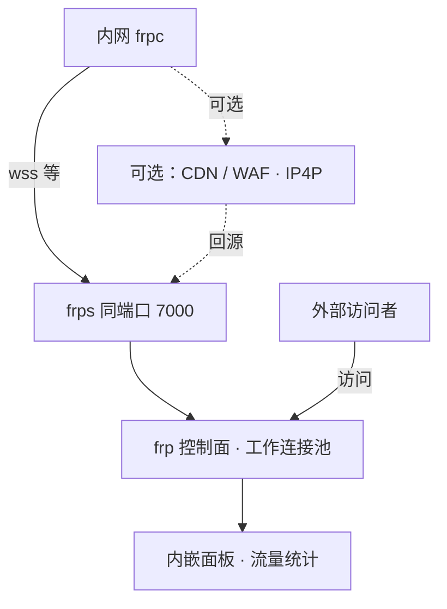
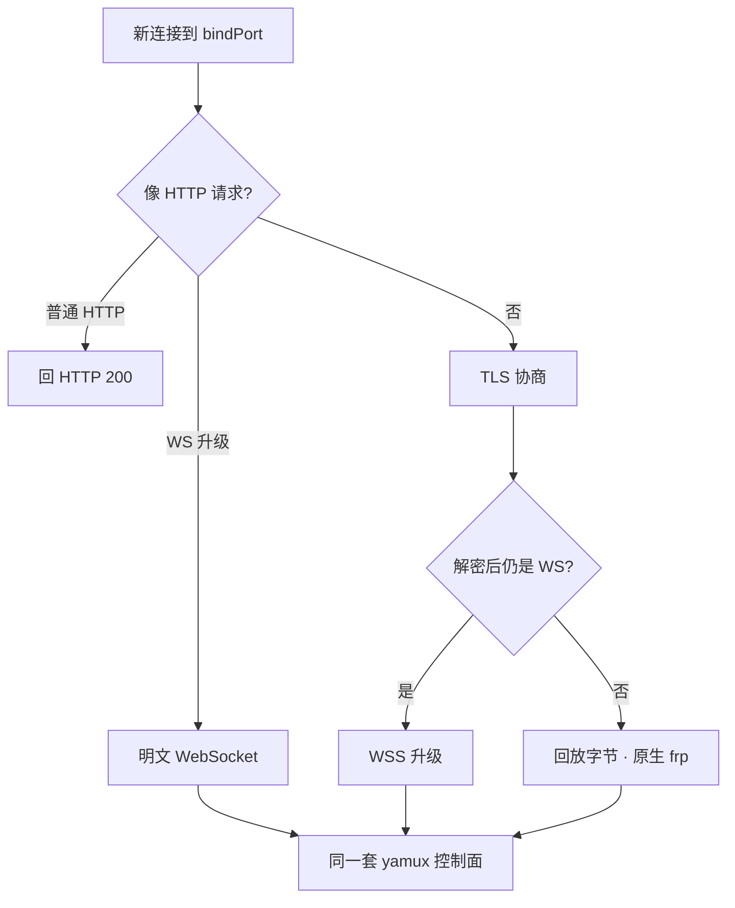
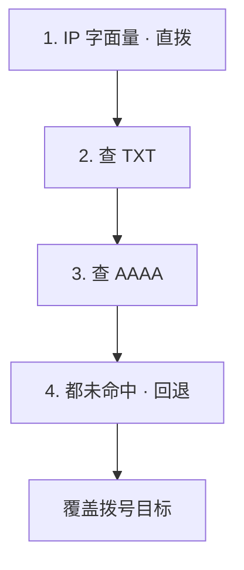

# rust-frp-wss-ip4p

[](https://github.com/wengjing086/rust-frp-wss-ip4p/releases)
[](https://github.com/fatedier/frp)
[](https://www.rust-lang.org/)
[](https://github.com/wengjing086/rust-frp-wss-ip4p/releases)
[](LICENSE)

**用 Rust 写的 frps / frpc 整合发行版**：把三个仓库的能力合到一个项目里，
配置文件与官方 frp 完全保持一致，服务端同端口原生支持 WSS，客户端支持 IP4P，
并针对 Windows 安全软件的误报做了合规处理。

先看一眼它长什么样 —— 左边是没公网 IP 的内网，右边是公网上的 frps：



> 从上到下：内网的 RDP / SSH / Web 接到 frpc，可经 CDN / WAF（路径任意）或直连公网；
> frps 在 `bindPort` 上自动识别 TCP / TLS / WS / WSS，之后是 frp 控制面与内嵌面板
> （真实 IP、归属地、流量）；外部访问者通过 remotePort 或 stcp 接入，隧道内字节原样往返。
> **WSS、IP4P、CDN 适配都不要改 `frps.toml`**，客户端只加官方本来就有的
> `transport.protocol = "wss"` 一行。

| 需求 | 实现 |
|---|---|
| ① `frps.toml` / `frpc.toml` **一个字都不用改** | 沿用上游 TOML / legacy INI 兼容层；WSS 与 IP4P 都是**自动探测**，零新增配置键 |
| ② frps / frpc 支持 **WSS** | frps 在 `bindPort` 上同时接受 TCP / TLS / WSS；frpc 用官方 `transport.protocol = "wss"` 直连，无需 nginx |
| ③ frpc 支持 **IP4P** | 拨号前解析 DNS TXT（base64/明文 `IP:端口`）→ IP4P AAAA 编码 → 回退普通模式 |
| ④ **不被杀毒软件误杀** | Rust 原生编译（无 Go 运行时特征）+ 完整版本资源 + `asInvoker` 清单 + 不加壳不混淆 + 可复现构建与 SHA256 校验 |
| ⑤ **放在 CDN / WAF 后面能连上** | 0.8.1：服务端按"HTTP 请求 + WebSocket 升级"判定，**路径随便配**（绕开 WAF 对 `/~!frp` 的 403），并对 CDN 回源健康检查回 200（消掉 520） |
| ⑥ 面板显示**真实 IP + 国内归属地** | `/api/v2/clients` 的 `clientIP` + `ipLocation`、`/api/status` 的 `client_ip_geo`；在线查询省市运营商，缓存 7 天，可关 |
| 修好代码并发布 | 源码在 GitHub，Release 提供多平台预编译二进制与 `SHA256SUMS.txt` |

---

## 项目来源与致谢

| 来源 | 取用了什么 |
|---|---|
| [Nu0vo1212/Rust-Frp](https://github.com/Nu0vo1212/Rust-Frp) (v0.7.6, Apache-2.0) | Rust 协议基座：`common` 协议/配置/加密/传输、`server`、`client` 三个 crate，与官方 frp v0.71.0 线协议互通 |
| [wengjing086/frp-wss-ipgeo](https://github.com/wengjing086/frp-wss-ipgeo) | frps **同端口 WSS 直连**的思路：TLS 解密后 peek `GET /~!frp`，命中走 WebSocket 升级，否则字节回放继续原生 frp |
| [wengjing086/frp-ip4p](https://github.com/wengjing086/frp-ip4p) | frpc 的 IP4P 解析规则：TXT（四种 base64 变体 / 明文）→ AAAA（`2001:0000::/16`）→ 回退普通模式，端口覆盖 `serverPort` |
| [fatedier/frp](https://github.com/fatedier/frp) | 线协议与配置文件格式（本项目按其文档实现互通，不含其源码） |

> 本项目是**整合发行版**，不是官方 frp，也不是 NFrp 的镜像。
> 归属与第三方许可见 [NOTICE](NOTICE)。

---

## 快速开始

### 1. 服务端（配置完全不用改）

沿用你现有的 `frps.toml`：

```toml
bindAddr = "0.0.0.0"
bindPort = 7000
auth.method = "token"
auth.token = "换成一个足够随机的强令牌"
```

```bash
frps -c frps.toml
```

`bindPort` 现在会**自动**同时接受 `tcp` / `tls` / `websocket` / `wss`，
靠的是两级嗅探 —— 明文层判一次，TLS 解密后再判一次：



判据是「**是不是一条合法的 WebSocket 升级请求**」，不是固定路径 `GET /~!frp`，
所以放在 CDN / WAF 后面可以把路径换成任意正常业务路径；安全边界由 token 认证把守，
不靠路径保密。官方 frps 只在 TLS **之前**嗅探，所以 `wss` 连它必须前置 nginx
终结 TLS —— 本项目省掉的正是这一层。

### 2. 客户端

沿用你现有的 `frpc.toml`。要用 WSS 只改官方本来就有的那一行：

```toml
serverAddr = "your.server.com"
serverPort = 7000
auth.method = "token"
auth.token = "和服务端一致的强令牌"

transport.protocol = "wss"     # 唯一新增的一行；官方 frpc 也是这么写

[[proxies]]
name = "ssh"
type = "tcp"
localIP = "127.0.0.1"
localPort = 22
remotePort = 6022
```

```bash
frpc -c frpc.toml
```

看到 `login to server success` 即成功。

### 2.1 放在 CDN / WAF 后面（0.8.1+）

CDN 场景有两个坑，**都不是客户端能单方面解决的**：

* `GET /~!frp` 会被 WAF 当扫描流量拦掉（实测阿里云 ESA 直接 `403 Forbidden`）；
* CDN 回源健康检查发 `GET /`，老 frps 不会答 HTTP ⇒ CDN 判源站不健康，对外 `520`。

0.8.1 起服务端按"合法 WebSocket 升级请求"判定，**路径不再限制**，并且对普通
HTTP 请求回 200。客户端只需要把路径换成"正常业务路径"，Host 用给 CDN 的域名：

```toml
[transport]
protocol = "wss"

[transport.tls]
serverName = "frps.example.com"   # ← 给 CDN 用的域名：TLS SNI + HTTP Host 都用它

[transport.websocket]
path = "/ws"                      # ← 绕开 WAF 对 /~!frp 的拦截
```

完整部署步骤（含 ESA 侧要改哪几项、怎么用 `probe_cdn.py` 分清 403 与 520）
见 [docs/CDN.md](docs/CDN.md)。

### 3. IP4P（同样不用改配置）

把 `serverAddr` 填成发布 IP4P 记录的域名即可，**无需任何新键**：

```toml
serverAddr = "your.ip4p.example.com"
# serverPort 可省略：TXT / AAAA 里解析出的端口会自动覆盖它
auth.token = "..."
```

客户端按以下顺序解析，命中即返回：

| 优先级 | 记录 | 内容 |
|---|---|---|
| 1 | TXT | `base64("IPv4:端口")`，如 `MjAzLjAuMTEzLjc6MTgyNDY=` ⇒ `203.0.113.7:18246`；也兼容明文 |
| 2 | AAAA | IP4P 编码 IPv6（`2001:0000::/16`），端口在字节 10–11，IPv4 在字节 12–15 |
| 3 | 回退 | 无匹配记录 ⇒ 原样使用 `serverAddr` + `serverPort`，与官方行为一致 |



日志示例：

```
ip4p: 由 TXT 记录解析出服务端地址 host=your.ip4p.example.com resolved=203.0.113.7:18246
```

`dnsServer`（官方已有键）若配置，TXT / AAAA 查询会走它；否则走系统 DNS。
`serverAddr` 是 IP 字面量时**完全跳过 DNS 查询**，零额外开销。

详见 [docs/IP4P.md](docs/IP4P.md)、[docs/WSS.md](docs/WSS.md) 与 [docs/CDN.md](docs/CDN.md)。

### 4. 面板里的真实 IP 与归属地（0.8.1+）

```jsonc
// GET /api/v2/clients?all=1
{ "clientIP": "223.5.5.5", "ipLocation": "浙江 杭州 阿里云", ... }

// GET /api/status → clients[]
{ "client_ip": "223.5.5.5", "client_ip_geo": "浙江 杭州 阿里云",
  "client_ip_full": "223.5.5.5 (浙江 杭州 阿里云)", ... }
```

* **只对中国大陆 IP 追加归属地**，境外 / 内网 / 保留地址只显示 IP；
* 在线查询（百度 open data → ip-api → ip.sb 依次降级），结果缓存 7 天到
  `ipgeo_cache.json`，重启不重查；
* 查询是异步的：面板第一轮可能只看到 IP，下一轮刷新就带上归属地，**不阻塞接口**；
* 放在 CDN 后面时，客户端 IP 取自 `X-Forwarded-For`，**必须先配白名单**：

```toml
trusted_proxies = ["10.0.0.0/8", "172.16.0.0/12"]   # CDN 回源网段
```

* 不想让 IP 出网就关掉：`ipgeo = false`（或环境变量 `NFRP_IPGEO=0`），
  此时不会发出任何一次查询。

---

## 从源码构建

要求 Rust 1.75+（推荐 stable）。本项目**不引入任何新的第三方依赖**，
所有能力都基于基座已有的 crate 实现。

```bash
cargo build --release
# 产物：target/release/nfrp-server(.exe)、target/release/nfrp-client(.exe)
# Release 包里按官方习惯重命名为 frps / frpc
```

质量门禁：

```bash
cargo fmt --all -- --check
cargo clippy --workspace --all-targets -- -D warnings
cargo test --workspace
```

Windows 版本资源由 `scripts/gen_winres.py` 生成，`.res` 已随仓库提交，
构建时**不需要** `rc.exe` / Windows SDK：

```bash
python scripts/gen_winres.py          # 重新生成（改版本号后）
python scripts/gen_winres.py --check  # 只校验结构
```

---

## 关于杀毒软件误报

Go 版 frp 常被报成 `HackTool:Win32/Frp` 之类，主因是 Go 运行时特征 + 隧道类
工具的历史滥用标签。本项目采取的都是**合规、可审计**的措施，不是免杀：

- Rust 原生编译，不含 Go 运行时；
- 完整 VERSIONINFO（公司 / 产品 / 描述 / 版本 / 版权 / 原始文件名）；
- 应用清单声明 `asInvoker`（不请求管理员权限）、DPI / 长路径感知；
- 不加壳、不压缩、不混淆、不注入、不自修改、不写自启动、不在运行时下载可执行内容；
- 全部二进制由仓库内 `scripts/build_all.sh` 从公开源码构建，附 `SHA256SUMS.txt`
  便于核验与申诉；仓库随源码提供 GitHub Actions 配置（已入库的 `ci/*.yml`），
  启用后承担 fmt / clippy / 单测门禁与独立的可复现性校验构建。

详见 [docs/ANTIVIRUS.md](docs/ANTIVIRUS.md)（含误报申诉渠道与自证清单）。
**没有任何措施能保证所有厂商零误报**；遇到误报请走正规申诉，而不是加壳。

---

## 与官方 Go 版 frp 的互通性

不是"声称兼容"，是拿**官方 frp 0.71.0 的真实二进制**双向跑出来的。判据是数据面真的通：
隧道里一个来回的字节必须原样回来，标了"8 MiB"的项还要整段 sha256 对齐。
脚本在 `_interop/compat_go.py`（`python _interop/compat_go.py`），可以自己复跑。

### 代理类型

| 服务端 | 客户端 | tcp | udp | http | https | tcpmux | stcp | sudp | xtcp |
|---|---|---|---|---|---|---|---|---|---|
| **本项目 frps** | 官方 go frpc 0.71.0 | ✅ | ✅ | ✅ | ✅ | ✅ | ✅ | ✅ | ✅ |
| 官方 go frps 0.71.0 | 本项目 frpc | ✅ | ✅ | ✅ | ✅ | ✅ | ✅ | ✅ | ❌ |

`stcp` 这一列是**四种组合全过**（谁做 provider、谁做 visitor 各测一遍，含 8 MiB 全量）。
混搭环境里要加密点对点，就选它 —— 数据经服务端转发，不依赖打洞。

`xtcp` 的 ✅ 只覆盖**两端同源**（都官方、或都本项目）。跨实现不行，因为牵线协议是两套：

- 官方 `xtcp` 的 provider 只在**工作连接**上读 `NatHoleSid`，压根不接中继数据；
  官方 visitor 也没有"打洞失败回退中继"这条路（`open tunnel timeout` 就结束）。
- 本项目的打洞是 frps `p2pPort` 上的 HELLO 牵线 + QUIC/KCP 直连；
  官方 frps 上没有这个 UDP 服务。
- 于是 `rust visitor + 官方 provider` 能接入中继，但官方 provider 那边 `read workConn: EOF`；
  `官方 visitor + rust provider` 则卡在服务端等 `NatHoleClient` 直到超时。

0.8.6 起这两种情况都会在日志里给出一行明确的 WARN 并指向 `stcp`，不再是干等超时。

### 传输层

| 服务端 | 客户端 | tcp | tls | websocket | wss | quic | kcp |
|---|---|---|---|---|---|---|---|
| **本项目 frps** | **本项目 frpc** | ✅ | ✅ | ✅ | ✅ | ✅ | ✅ |
| **本项目 frps** | 官方 go frpc 0.71.0 | ✅ | ✅ | ✅ | ✅ | ✅ | ❌ |
| 官方 go frps 0.71.0 | 官方 go frpc 0.71.0 | ✅ | ✅ | ✅ | ❌ | ✅ | ✅ |
| 官方 go frps 0.71.0 | 本项目 frpc | ✅ | ✅ | ✅ | ❌ | ✅ | ❌ |

三个反直觉的格子，都值得单独说明。

**1. wss 那一列：官方 frps 连自己也不支持直连。**
官方 frps 是在 **TLS 之前**按明文前缀 `GET /~!frp` 嗅探 WebSocket 的
（`server/service.go` 的 mux 前缀匹配）。`wss` 首字节是 `0x16`，会被当成普通 frp 连接
丢给 yamux，日志里只剩一句 `accept new mux stream error: invalid protocol version`。
官方文档的解法是前面挂 nginx/caddy 终结 TLS。
本项目的 frps **两种顺序都认**，所以 `官方 frpc --wss--> 本项目 frps` 是通的，可以省掉 nginx；
反方向（本项目 frpc → 官方 frps）受官方限制，同样不通。

**2. quic 那一列是 0.8.6 修出来的。**
QUIC 的 ALPN 之前用的是私有标识 `nfrp-frp`，官方用的是 `frp`
（`client/connector.go` 与 `server/service.go` 里写死的 `NextProtos`）。
ALPN 不一致时 QUIC 直接以 `cryptographic handshake failed: error 120` 断开，
两端日志都看不出原因 —— 表现为"QUIC 就是连不上"。
现在两端同时接受 `frp` 与 `nfrp-frp`，官方客户端/服务端都能直连，旧版本 nfrp 也不受影响。

**3. kcp 不支持跨实现，是设计选择。**
本项目的 KCP 是 `ikcp` / `kcp-go` 的精简移植，只实现两端都用得到的部分
（分片重组、UNA/ACK、快速重传），**没有 FEC**，也没做 kcp-go 的会话握手；
`common/src/frp/kcp.rs` 的模块注释里写得很明白："两端都是 nfrp，所以不需要与 kcp-go
的字节流严格对齐"。官方 frp 的 KCP 默认带 FEC 150/3，字节层面就对不上。
跨官方请用 `tcp` / `tls` / `websocket` / `quic`。

混搭时最稳的是 `tcp` 与 `tls`，四种组合全绿。


## 生产部署建议配置

以下几项**默认值直接影响公网部署的安全与资源上限**，以前只在源码注释里写过，
这里集中列出来。配置项都是 `frps.toml` 的顶层键。

### 连接数上限（v0.8.7 起有了保守默认值）

| 配置键 | 作用 | v0.8.7 默认 | 显式设 `0` |
|---|---|---|---|
| `max_total_conns` | 全局同时活跃的转发连接数 | `5000` | 不限 |
| `max_conns_per_client` | 单个客户端同时活跃的转发连接数 | `200` | 不限 |
| `max_pending_per_client` | 单个客户端排队等工作连接的请求数 | `64` | 不限 |
| `max_clients` | 同时在线客户端数 | `0`（不限） | — |
| `max_proxies_per_client` | 单个客户端可注册的代理数 | `0`（不限） | — |

v0.8.6 及以前这五项**全是 `0`（不限）**：只要一个认证通过的客户端不停建连，
tokio task 数量就会线性上涨。目前预认证握手有独立闸门（`PREAUTH_MAX = 2048`、
5 秒等待），但认证后的转发连接此前没有上限。如果你的客户端特别多或单客户端
并发很高，按实际容量调大即可；想恢复旧行为就显式写 `0`。

```toml
# frps.toml（一般不用写，下面是默认值）
max_total_conns = 5000
max_conns_per_client = 200
max_pending_per_client = 64

# 对外提供服务时强烈建议同时配端口白名单
allowPorts = ["20000-40000"]
```

### 报文大小与 TLS 校验

- **`udpPacketSize` 默认 `65507`，官方 frp 默认 `1500`。** 这是历史行为，
  为了让现有用户的大 UDP 报文不被截断而保留；取值范围 `[1, 65507]`。
  跨实现混搭时若对端按 1500 分片，行为会有差异，遇到大包问题优先检查这一项。
- **`transport.tls.enable = true` 默认并不校验证书**（与官方 frp 一致，
  `InsecureSkipVerify = true`）。它能防被动窃听，但**不能防主动中间人**。
  不改默认是为了保住「官方 frpc 零配置直连」这条链路；自有 CA + 两端都是
  本项目的部署，建议显式开启校验：

  ```toml
  # frpc.toml
  [transport.tls]
  trustedCaFile = "/etc/ssl/ca.pem"   # 服务端证书或签发它的 CA
  tlsServerName = "frps.example.com"  # 必须能对上证书里的名字
  verifyServerCert = true
  ```

  开启后**官方 frpc 默认连不上**（它不提供客户端证书），所以这个开关只适合
  「自有 frpc + 自有 frps」的闭环部署，混搭场景请保持默认。
- 前端有反代 / CDN 时，把回源网段写进 `trusted_proxies`，否则 `X-Forwarded-For`
  之类的来源信息不可信。

---

## 兼容性与限制

- 线协议兼容官方 frp **v0.71.0**（v1 默认，可选 v2）；`frpc -v` 输出仍为裸 `0.71.0`。
- `frps` / `frpc` 与官方二进制可混搭；第三方 frp 服务商下发的配置可直接使用。
- WSS 直连是**服务端增强**：连未打补丁的官方 frps 时，wss 仍需前置 nginx 终结 TLS。
- IP4P 只作用于客户端拨号路径（TCP / WS / WSS / KCP / QUIC）；xtcp 打洞的
  rendezvous 地址仍按 `serverAddr` 处理，与 Go 版补丁范围一致。
- `serverAddr` 是域名时会做一次 TXT/AAAA 探测；命中缓存 10 秒、未命中缓存 60 秒。
- 反向代理 / nginx 场景：wss 客户端的 TLS SNI 与 WebSocket Host 仍使用配置里的
  原始域名，IP4P 只改变实际连接目标，不会破坏按 Host 分流与证书校验。

### 已知不支持（不是 bug，别当成故障排查）

这些是源码里明确写出的取舍，散落在注释里容易踩坑，集中列在这里：

| 项 | 说明 |
|---|---|
| KCP 跨实现 | 本项目 KCP 是 `ikcp` / `kcp-go` 的精简移植，无 FEC、无 kcp-go 会话握手，字节层面不与官方互通。跨官方请用 `tcp` / `tls` / `websocket` / `quic`。 |
| 本项目 frpc `--wss-->` 官方 frps | 官方 frps 在 TLS **之前**做明文 `GET /~!frp` 前缀嗅探，wss 密文无法命中；官方自己的客户端也不支持这种直连，需前置 nginx 终结 TLS。 |
| xtcp 跨实现 / xtcp 连官方 frps | 官方 provider 只认 `NatHoleSid`、不接中继通道，官方 visitor 也没有中继回退；官方 frps 不提供 xtcp 中继端口。跨版本需要 P2P 时请改用 `stcp`（四种组合实测全通，含 8 MiB）。 |
| VirtualNet 的 TUN 设备（macOS） | 平台层未实现，会**明确报错**，不会假装成功；Linux / Windows 可用。 |
| legacy `frpc.ini` 里的 `tcpmux` | 旧 INI 解析路径不支持该类型，会报错而非静默降级。**TOML 配置路径的 tcpmux 是支持的**，上面的互通矩阵标 ✅ 指的是 TOML。 |
| OIDC discovery 遇到 302 | 内置 HTTP 客户端不支持 HTTP/2、重定向、cookie。个别 IdP 的 discovery 文档会 302，请把 `tokenEndpointURL` / `issuer` 直接写成最终地址。 |
| `protocol = "nfrp"` 之类的自研协议 | 尚未实现，配置选到会直接报错；请用 `frp-v1`（默认）或 `frp-v2`。 |
| Windows ARM64 二进制 | 构建需要 clang + gnullvm，当前环境缺 clang，v0.8.6 / v0.8.7 未提供；以 Release 的 `SHA256SUMS.txt` 实际列出的文件为准。 |

跨实现实测细节见 `_interop/compat_go.py`（41 项用例，可自行复跑）。

---

## 安全与免责声明

- 部署到公网请务必使用**强 token**（至少 16 位、含大小写/数字/符号）、开启 TLS
  并限制 `allowPorts`。v1 登录凭证是 `md5(token + timestamp)`，服务端虽有 ±300 秒
  新鲜性窗口，但窗口内抓到一条 Login 仍能离线枚举 token，PBKDF2 的 64 轮帮不上忙
  —— token 强度只能靠自己。启动时会对此告警。
- **「开启 TLS」不等于防中间人**：默认不校验证书（见上节），只防被动窃听。
  需要防主动 MITM 请在自有两端显式开启 `verifyServerCert` + `trustedCaFile`。
- `panic = "abort"` 是有意的体积取舍，意味着任一连接任务 panic 会终止整个进程。
  部署在 Linux / OpenWrt 时请让 procd 或 systemd 配 `respawn` / `Restart=always`，
  把「全服掉线」降级成「自动拉起」；本项目自带的 procd 脚本已包含该设置。
- 本软件仅供在**你拥有或获得明确授权**的设备与网络上使用；使用者须自行遵守
  所在地法律法规。
- 许可证：**Apache License 2.0**，见 [LICENSE](LICENSE) 与 [NOTICE](NOTICE)。
