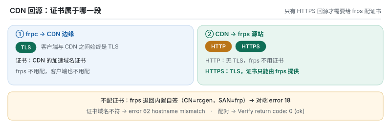

# 放在 CDN / WAF 后面：完整教程与原理

> 适用版本：**0.8.1 及以后**。以阿里云 ESA 为例，Cloudflare、自建 nginx / Caddy
> 反代同理。0.8.0 及更早只认固定路径 `GET /~!frp` 且不会回答普通 HTTP 请求，
> 放在 CDN 后面无法工作。
>
> 配套文档：[WSS.md](WSS.md)（传输层原理）、[IP4P.md](IP4P.md)（无公网 IP 时拨号）、
> [TROUBLESHOOTING.md](TROUBLESHOOTING.md)（按症状速查）。

---

## 0. 先记住三个结论

1. **路径无关。** 本项目 frps 判定的是「是不是一条合法的 WebSocket 升级请求」，
   **不看请求路径**。把客户端 `websocket.path` 改成任意「正常业务路径」都**不会**
   解决任何问题，服务端也不需要跟着配路径。凡是以「改个路径绕开 WAF」为思路的
   配置都是无效的，不要照做。
2. **CDN 返回 403，绝大多数是握手请求缺少 `Origin` 头**，不是路径被拦。
3. **CDN 返回 520 / 521，是源站不会说 HTTP**（健康检查拿不到响应，或根本连不上），
   需要 0.8.1+ 的 frps，以及正确的回源协议 / 端口 / 监听地址。

这三条决定了后面所有配置：真正要做的是把 **Origin 头**、**源站 HTTP 响应**、
**回源链路** 三件事弄对，而不是折腾路径。

---

## 1. 拓扑与数据走向

```text
  frpc（内网）                CDN 边缘                    frps（源站）
  ┌──────────┐             ┌──────────────┐            ┌──────────────┐
  │ wss 拨号 │──TLS(1)────▶│ 终结 TLS      │──HTTP(2)──▶│ bindPort 7000│
  │          │             │ 转发 WS 升级  │            │ 两级嗅探     │
  │ frp v1   │◀──WS 帧─────│ 转发 WS 帧    │◀──WS 帧───│ yamux 控制面 │
  └──────────┘             └──────────────┘            └──────────────┘
                                   │
                                   └── 周期性 GET / 健康检查（独立请求）
```

* **TLS(1)**：客户端到 CDN 边缘，用 CDN 的证书，域名是加速域名。
* **HTTP(2)**：CDN 到源站的回源，默认按 HTTP 明文转发到 `bindPort`；
  若选 HTTPS 回源，则源站要配证书，frps 会在 TLS 解密后再判一次 HTTP。
* 隧道里跑的仍是标准 frp v1 控制面与数据面，CDN 只做「把 WebSocket 帧搬过去」。

---

## 2. 原理：CDN 到底对源站做了什么

CDN 是 HTTP 世界的产品，它对源站有三类独立行为，任何一类没被满足都会失败：

| 行为 | 具体请求 | 期望响应 | 不满足时的现象 |
|---|---|---|---|
| 健康检查 | 周期性 `GET /`（或 `/health` 等） | 2xx | 源站被标记不健康，对外 `520` / `521` / `403` |
| 转发握手 | `GET <任意路径> HTTP/1.1` + `Upgrade: websocket` + `Connection: Upgrade` | `101 Switching Protocols` | 客户端看到 `403` / `404` / `502` |
| 分流寻址 | 按 HTTP `Host` 与 TLS `SNI` 选站点 | 命中站点配置 | `403` / `502`，请求根本不到源站 |

### 2.1 健康检查为什么会把老 frps 判死

老 frps 的 `bindPort` 只会说两种东西：明文 frp 字节流，或 TLS 字节流。
CDN 发来 `GET / HTTP/1.1` 时，它要么把这串 ASCII 当成 frp 消息类型解析失败后断开，
要么拿去当 TLS ClientHello 协商失败后断开 —— **总之不会回一个合法 HTTP 响应**。
CDN 收不到响应头，记 `error=http_response_incomplete`，对外给 `520`。

### 2.2 WebSocket 升级为什么要专门转发

升级请求本质是普通 HTTP 请求，只是多了两个头：

```http
GET /~!frp HTTP/1.1
Host: frps.example.com
Upgrade: websocket
Connection: Upgrade
Sec-WebSocket-Key: ...
Sec-WebSocket-Version: 13
Origin: http://frps.example.com
```

CDN 必须把 `Upgrade` / `Connection` 原样透传到源站，并允许 WebSocket 长连接
（不能当普通请求缓存或超时断开）。源站必须回 `101` 并切换到 WebSocket 帧协议。
**路径只是请求行的一部分，服务端判定时不参与匹配。**

### 2.3 `Host` / `SNI` 决定请求落到哪个站点

`serverAddr` 写成 IP（或用 IP4P 域名解析成 IP）时，TLS SNI 与 HTTP Host 会变成 IP，
CDN 找不到对应站点。所以客户端必须显式给 `transport.tls.serverName = "加速域名"`，
本项目客户端的 Host 回落顺序是：

```text
websocket.host  →  tls.serverName  →  serverAddr
```

---

## 3. 原理：本项目 frps 的「两级嗅探」

`server/src/serve.rs` 的 `handle_conn()` 对新连接做三层判定，这也是 WSS 能
**和原生 frp 共用同一个 `bindPort`** 的原因：

```text
读取首字节（1 byte，带超时）
  │
  ├─ 第 1 层：明文 HTTP 判定（probe_http）
  │    请求行含 " HTTP/1." ?
  │      是 + Upgrade: websocket  → ws::accept() → 明文 WebSocket → WS 内的 frp
  │      是 + 普通 HTTP           → 健康检查回 200（/、/health*、/status），其它 404
  │      否                       → PrefixedStream 把读过的字节无损回放
  │
  ├─ 第 2 层：TLS 协商
  │    0x16 标准 ClientHello / 0x17 frp 自定义首字节 / 其它明文透传
  │
  └─ 第 3 层：在 TLS 解密后的流上 **再判一次 HTTP**（本项目新增）
       仍是 WS 升级 → WSS 升级 → frp 控制面
       不是         → 字节无损回放 → frp over TLS / 原生 TCP
```

关键点：

* **判据与路径无关**：代码只检查 `first_line.contains(" HTTP/1.")` 与
  `Upgrade: websocket` 头，没有对请求路径做任何比较。因此客户端写什么路径都行，
  CDN 做路径改写也不会破坏握手。
* **健康检查走第 1 层**，所以 HTTP 回源时 `GET /` 能拿到 `200 ok`；
  **HTTPS 回源走第 3 层**，解密后同样能拿到 200，两种回源协议都支持。
* **字节无损回放**：`probe_http` 最多读到 `\r\n\r\n`（上限 16 KiB），不匹配就
  用 `PrefixedStream` 把字节塞回流最前面。非 HTTP 客户端最多多读 4 个字节，
  行为与改造前完全一致 —— 这也是「同端口同时接 tcp/tls/ws/wss」不会互相干扰的原因。
* 官方 frps 只在 **TLS 之前**按明文前缀嗅探，`wss` 的首字节是 `0x16`，会被当成
  普通 frp over TLS 丢给 yamux，所以官方方案必须前置 nginx 终结 TLS；
  本项目多做的第 3 层省掉了这一层。

> 结论：服务端**没有任何与路径相关的配置项**，`frps.toml` 里也不需要为 CDN 加东西。

---

## 4. 原理：403 的真因是 `Origin`，不是路径

实测（2026-11，阿里云 ESA，**WAF 规则全部放行**）：

```text
GET /~!frp  无 Origin                →  403 Forbidden        Server: ESA
GET /~!frp  +Origin                  →  101 Switching Protocols   ← 通了
GET /~!frp  +User-Agent（无 Origin） →  403 Forbidden
GET /~!frp  +Origin +UA +Protocol    →  101 Switching Protocols
```

云 WAF 普遍把「带 `Upgrade: websocket` 却不带 `Origin`」当作非浏览器发起的
自动化流量直接 403，响应体为空，**在控制台放行任何路径都无效**，因为请求根本
没走到路径规则那一步。

官方 Go 版 frpc 能过，是因为 `golang.org/x/net/websocket` 的 `Dial()` 必然会写
`Origin: http://<host>`。0.8.1 起本项目客户端自动携带该头（值按第 2.3 节的回落
顺序取，与 `Host` 同源），无需配置。

> **判断口诀**：同一条链路，Go 版 frpc 通、其它客户端 403 ⇒ 先怀疑缺 `Origin`。
>
> **反面结论**：既然 403 与路径无关，「把路径换成普通业务路径」对 403 没有作用；
> 若带 `Origin` 仍 403，去查 WAF 自定义规则、地域封禁、速率限制，而不是改路径。

---

## 5. 从零部署

### 5.1 服务端（frps）

先按 CDN 的**回源协议**选模板 —— 这两份只有一处差别：要不要证书。

| 回源协议 | 用哪份模板 | frps 要不要证证书 |
|---|---|---|
| **HTTP**（默认，推荐先用它跑通） | [`assets/frps.cdn.toml`](../assets/frps.cdn.toml) | **不要** |
| **HTTPS**（回源段也加密） | [`assets/frps.cdn-https.toml`](../assets/frps.cdn-https.toml) | **必须**，见 5.4 |

HTTP 回源的完整模板（可直接复制运行）：

```toml
bindAddr = "::"          # 家宽无公网 IPv4、CDN 走 IPv6 回源时必须是 "::"，见第 8 节
bindPort = 7000          # CDN 的「源站端口」填这个
trusted_proxies = ["10.0.0.0/8", "172.16.0.0/12"]   # CDN 回源网段，用于还原真实 IP
ipgeo = true             # 可选：面板显示归属地
allowPorts = ["20000-30000"]                        # 建议：限制隧道可申请的公网端口

[auth]
method = "token"
token = "换成一个足够随机的强令牌"
```

> **顺序很重要**：`bindAddr` / `bindPort` / `trusted_proxies` 这些都是**顶层键**，
> 必须写在 `[auth]` 这类表头之前。TOML 里表头之后的所有裸键都会归入那张表，
> 语法合法但会被 serde 静默忽略 —— 表现为「配了 `trusted_proxies` 却还是显示 CDN 节点 IP」。

**不需要**为 CDN 写 `[transport] protocol = "wss"`、`websocket.path` 或任何证书
（HTTP 回源时）：服务端在 `bindPort` 上按连接内容自动判定 tcp / tls / ws / wss，
没有任何与路径、Host 相关的配置项。

改完先预检，再启动：

```bash
frps --check -c frps.cdn.toml      # 不绑端口；证书能否装载、CIDR 是否合法在这里暴露
# 配置 frps.cdn.toml 合法

./frps -c frps.cdn.toml
```

启动后**先在源站本机自检**（必须返回 200）：

```bash
curl -i http://127.0.0.1:7000/
# HTTP/1.1 200 OK
# Content-Type: text/plain; charset=utf-8
# ok
```

> 启动日志里若出现 `未强制 TLS（transport.tls.force = false）`：
> HTTP 回源时这条是**有效告警** —— CDN 到源站这一段是明文，token 在回源段可被嗅探。
> 想消掉它只有两条路：改 HTTPS 回源（见 5.4），或接受「回源段明文」这个前提。

### 5.2 CDN 控制台（以阿里云 ESA 为例）

| 项目 | 建议值 | 为什么 |
|---|---|---|
| 加速域名 | `frps.example.com` | 与客户端 `tls.serverName` 一致 |
| 源站地址 | 源站公网 IP 或域名 | 家宽无 IPv4 时填 IPv6 地址 |
| 源站端口 | `7000` | 与 `bindPort` 一致 |
| 回源协议 | **HTTP**（源站是明文 frps） | 选 HTTPS 需要源站配证书，见 5.4 |
| 回源 Host / SNI | 加速域名 | 与客户端 `Host` / `serverName` 同源 |
| WebSocket | **开启** | 关掉会拿不到 101 |
| 健康检查 | `GET /`，期望 2xx | frps 对该路径回 200 |
| 缓存 | 全部关闭 / 绕过 | 升级请求被缓存层拦下会失败 |
| 强制 HTTPS 跳转 | 关闭（或确保不重定向 WS 升级） | 301/302 会打断握手 |
| WAF 自定义规则 | 放行 WS 升级请求 | 见第 4 节；**不要靠改路径绕过** |

### 5.3 客户端（frpc）：最小可用配置

```toml
serverAddr = "frps.example.com"   # 加速域名；写成 IP 时必须配下面的 serverName
serverPort = 443                  # CDN 对外端口（HTTPS）

[auth]
method = "token"
token = "和服务端一致的强令牌"

[transport]
protocol = "wss"

[transport.tls]
serverName = "frps.example.com"   # TLS SNI + HTTP Host + Origin 都取它
verifyServerCert = true           # CDN 用的是正规证书，建议开启校验
```

说明：

* **不要写 `[transport.websocket] path`**：默认路径 `/~!frp` 在带 `Origin` 的前提下
  实测就能拿到 101；服务端不校验路径，改它不产生任何效果。
* **`verifyServerCert = true` 建议开着**：连 CDN 时对面用的是正规证书，能真正验证
  「这是 CDN」。例外：CDN 用了私有 CA、或运行环境缺根证书导致握手报证书错误 ——
  这时把该 CA 填进 `trustedCaFile`，或退回 `false`（只防窃听、不验证对方身份）。
* `protocol = "wss"` 已经包含 TLS（内部等价于 `tls.enable = true`），再写一遍
  `tls.enable` 不会多一层。想让 CDN 看不到隧道**里面**的内容，要开
  **数据面加密**：`[transport] useEncryption = true`（见 [CONFIG.md §6](CONFIG.md)）——
  它加密的是 frp 数据帧，与 CDN 终结的外层 TLS 互不冲突。
* `Origin` 由客户端自动补，值按 `websocket.host → tls.serverName → serverAddr` 回落，
  与 `Host` 同源。

### 5.4 HTTPS 回源：frps 必须配证书

这一段是**唯一需要动证书**的场景。先说清楚证书到底属于哪一段链路：

| 链路 | 谁提供证书 | frps 要配吗 |
|---|---|---|
| frpc → CDN 边缘 | CDN（加速域名的证书） | 不要 |
| CDN → frps（**HTTP 回源**） | 这一段没有 TLS | 不要 |
| CDN → frps（**HTTPS 回源**） | **只能由 frps 提供** | **必须配** |



也就是说：**用了 CDN 不等于要给 frps 配证书**，只有当你把回源协议选成 HTTPS 时才是。
反过来说，一旦选了 HTTPS 回源又不配证书，frps 会退回启动时自动生成的自签证书 ——
而那张证书是给「客户端不校验」的场景用的，CDN 一校验就必然失败。

#### 5.4.1 配置写法

完整模板见 [`assets/frps.cdn-https.toml`](../assets/frps.cdn-https.toml)。相对 HTTP 回源
只多一个表：

```toml
# ... 顶层键与 HTTP 回源完全一致（bindAddr / bindPort / trusted_proxies / allowPorts）
# 注意：[transport.tls] 是表头，必须放在所有顶层键之后、[auth] 之后也可以

[auth]
method = "token"
token = "换成至少 16 位的随机强令牌"

[transport.tls]
certFile = "/etc/nfrp/certs/fullchain.pem"
keyFile  = "/etc/nfrp/certs/privkey.pem"
```

三条硬性要求：

1. **`certFile` 与 `keyFile` 必须同时配置**。只配一个 frps 直接启动失败，错误是
   `transport.tls.certFile 与 keyFile 必须同时配置（当前只配了一个）`。
2. **证书里的域名必须覆盖 CDN 回源使用的 SNI / Host**（通常就是加速域名）。
   域名对不上时，握手会以 `hostname mismatch` 失败 —— 证书本身再正规也没用。
3. **`certFile` 要放 fullchain**（服务器证书 + 中间证书）。只给叶子证书时，
   部分 CDN 会判「证书链不完整」。

证书可以从这三处来，都能用：

* 云厂商 / 正式 CA 签发的证书（最省事，CDN 天然信任）；
* **Let's Encrypt**：家宽没有 80 端口就用 `acme.sh --dns` 的 DNS-01 方式签发，
  之后把 `fullchain.pem` 与 `privkey.pem` 指给 frps；
* 自签（仅限下面 5.4.4 的两种情形）。

#### 5.4.2 不配证书会怎么样（实测）

不配 `[transport.tls]` 时，frps 用的是进程启动时生成的自签证书。实测它长这样：

```text
subject = CN=rcgen self signed cert
issuer  = CN=rcgen self signed cert
X509v3 Subject Alternative Name:
    DNS:frp                      ← 固定是 "frp"，不是你的域名
```

于是任何**会校验证书**的对端（CDN 的 HTTPS 回源就是）都会拒绝：

| 情形 | 对端看到的结果（openssl 实测原文） | CDN 侧通常表现为 |
|---|---|---|
| 不配证书，对端校验证书 | `verify error:num=18:self-signed certificate` | 521 / 525 / 526 或 `ssl_handshake_failure`（各家码不同） |
| 配了证书，但域名对不上 | `verify error:num=62:hostname mismatch` | 同上，日志里常带 `certificate is not valid for the requested name` |
| 配了证书且域名正确 | `Verify return code: 0 (ok)` | 正常，健康检查与 WS 升级都能走通 |
| 不配证书，但对端**关闭**了证书校验 | 握手能成，但 `Verify return code: 18` | 能通 —— 但等于不验证源站身份，中间人可以冒充源站 |

最后一行是常见的「把它调通再说」做法：在 CDN 控制台关掉「校验源站证书」，
自签也能握手成功。**它解决的是可用性，不是安全性** —— 流量仍然加密，
但 CDN 不再确认对面真的是你的 frps。

另外别忘了 HTTP 回源那条：CDN 到源站是**明文 HTTP**，token 在回源段裸奔。
选 HTTPS 回源 + 配证书，才把这一段也盖住。这也是 frps 启动日志里
`未强制 TLS（transport.tls.force = false）` 那条告警在 CDN 场景下的真实含义。

#### 5.4.3 配错了会怎么样（`--check` 实测原文）

`frps --check -c frps.cdn-https.toml` 不绑端口，但会真的去装载证书，
所以在 systemd reload / 重启生产之前先跑它：

| 配错方式 | 报错原文 |
|---|---|
| 只写 `certFile`，没写 `keyFile` | `Error: transport.tls.certFile 与 keyFile 必须同时配置（当前只配了一个）` |
| `keyFile` 路径写错 / 文件不存在 | `Error: 读取 PEM 文件 ... 失败` → `系统找不到指定的文件。 (os error 2)` |
| `certFile` 误填成私钥文件 | `Error: 证书文件 ... 里没有 CERTIFICATE 块` |
| 只配 `trustedCaFile`（想做 mTLS） | `Error: 配置了 transport.tls.trustedCaFile，但没有 certFile/keyFile` |
| 全空 | 不报错 —— 退回自签证书，也就是上面 5.4.2 的第一种情形 |

注意 `--check` 只能证明**证书能被装载**，不能证明**CDN 会信任它**。
域名是否匹配、证书链是否完整、CDN 有没有该校验证书，只能在边缘侧验证（见 5.5）。

#### 5.4.4 自签证书的两种可用情形

确实不想买 / 不想申请证书时，自签也能用，但必须满足其一：

* **CDN 控制台关闭「校验源站证书」**（可用性达标，安全性打折，见上表）；
* **把自签 CA 上传到 CDN 的自定义证书链**，让 CDN 认它。

自签时要注意：**不要沿用 frps 内置那张**（CN 是 `rcgen`，SAN 固定 `frp`），
要自己签一张把加速域名写进 SAN 的，例如：

```bash
openssl req -x509 -newkey rsa:2048 -nodes -days 365 \
  -keyout privkey.pem -out fullchain.pem \
  -subj "/CN=frps.example.com" \
  -addext "subjectAltName=DNS:frps.example.com"
```

#### 5.4.5 两个容易忽略的限制

* **换证书必须重启 frps，不能热重载**。rustls 的服务端配置是进程全局的，
  源码会明确拒绝中途更换：`服务端 TLS 配置已用另一组 certFile/keyFile/trustedCaFile 初始化...请重启进程`。
  Let's Encrypt 自动续期后记得加一条 `reload-or-restart frps` 的钩子。
* **`[transport.tls]` 管不到 QUIC**。QUIC 永远用固定自签证书（内部名字 `nfrp.frp`），
  也没有配置项可以换。所以 CDN 场景不要选 QUIC —— 它既不能被 HTTP CDN 代理回源，
  也没法拿正式证书。CDN 回源认准 `wss`。

### 5.5 验证顺序（不要跳步）

```bash
# ⓪ 配置预检：不绑端口，语法 / CIDR / 证书能否装载都在这步暴露
frps --check -c frps.cdn-https.toml
# 配置 frps.cdn-https.toml 合法

# ① 源站自检：直连 frps 端口，普通 HTTP 必须 200
curl -i http://<源站IP>:7000/

# ①' 仅 HTTPS 回源：确认源站出示的是你自己的证书，不是内置自签
openssl s_client -connect <源站IP>:7000 -servername frps.example.com </dev/null 2>/dev/null \
  | openssl x509 -noout -subject -ext subjectAltName
# 期望：CN / SAN 是加速域名
# 若是 CN=rcgen self signed cert + DNS:frp，说明 [transport.tls] 没生效或路径写错

# ② 边缘自检：向 CDN 发一条 WS 升级请求，期望 101
python _interop/probe_cdn.py frps.example.com 443 /~!frp /

# ③ 客户端
./frpc -c frpc.toml      # 出现 login to server success 即成功
```

第 ② 步拿到 `521` / `525` / `526` 时，先在 CDN 控制台确认「回源协议」与
「是否校验源站证书」，再回到第 ①' 步看源站到底出示了什么 —— 顺序反了会白折腾。

* ① 不通过 ⇒ 源站版本不对（不是 0.8.1+）或端口/协议填错。
* ② 不通过 ⇒ 问题在 CDN 边缘（403 查 Origin/WAF，520 查回源）。
* ③ 不通过但 ② 是 101 ⇒ 只剩 token 不一致或 `tls.enable` 组合问题，
  看服务端日志里的认证结果与 `WebSocket（明文）/ WSS（TLS 内 WebSocket）控制连接已建立`。

---

## 6. 排障矩阵

| 现象 | 判据 | 原因 | 处理 |
|---|---|---|---|
| `403` + `Server: ESA` / `cloudflare` | 响应来自边缘，源站日志无记录 | 多数是握手缺 `Origin`；其次 WAF 自定义规则 / 地域封禁 | 确认客户端是 0.8.1+；用 `probe_cdn.py` 看响应头；查 WAF 规则。**不要改路径** |
| `404` | 源站回了 HTTP 但路径未命中健康检查白名单 | 请求被判为普通 HTTP（通常是 `Upgrade` 头被反代剥掉） | 检查 CDN / nginx 是否透传 `Upgrade` 与 `Connection` |
| `520` + `error=http_response_incomplete` | 到了源站但没拿到合法 HTTP 响应 | 源站是旧版 frps，或回源协议填成 HTTPS 而源站是明文 | 升到 0.8.1+；回源协议选 HTTP；用 `curl -i` 直连源站验证 |
| `521 Origin Down` | 连不上源站端口 | 源站没监听 / 防火墙 / **只监听 IPv4 而 CDN 走 IPv6 回源** | 看第 8 节，`bindAddr = "::"` |
| `101` 但 frpc 登录失败 | 握手成功，认证阶段失败 | token 不一致，或内外层 TLS 组合不对 | 服务端日志会明确写认证失败；对齐 `auth.token` |
| 能用但面板 IP 全是 CDN 地址 | 面板显示回源 IP | 没配 `trusted_proxies` | 见第 7 节 |
| 连接偶发断开 | 长时间空闲后被断 | CDN 空闲超时 / 缓存层介入 | 关缓存、调长 WebSocket 空闲超时、配 `heartbeatInterval` |

`_interop/probe_cdn.py` 会把每条路径的响应头原样打印，是区分「边缘拒」与「源站挂」
最快的工具：看 `Server` 头和 `proxy-status`，再对照服务端日志有没有这条请求。

---

## 7. 真实客户端 IP 与安全

```toml
# frps.toml —— 只采信这些地址发来的 X-Forwarded-For
trusted_proxies = ["10.0.0.0/8", "172.16.0.0/12"]
```

* 默认空列表 = **永远不采信**。否则任何人都能伪造 `X-Forwarded-For` 自称
  `127.0.0.1`，直接绕过 IP 黑名单。
* 填 CDN 的回源网段（阿里云 ESA 的地址段见其文档；自建 nginx 同机填 `127.0.0.1/32`）。
* CDN 只负责把流量送到源站，**认证仍然是 frp 的 token**：
  用强 token、能开 `tls.force = true` 就开、开面板必须设 `webServer.user` / `password`。

---

## 8. 家宽无公网 IPv4：`bindAddr` 必须写 `::`

真实案例（2026-11）：源站是家宽 + 移动宽带，没有公网 IPv4，CDN 回源走
**IPv6 直连源站 7000 端口**（ESA 边缘节点连 `[IPv6]:7000`）。Go 版 frps 的
`net.Listen` 默认双栈（`[::]:7000` 同时收 IPv4/IPv6），而 Rust 版默认
`bindAddr = "0.0.0.0"` **只监听 IPv4** —— CDN 回源全部 `connection_refused`，
面板报 `521 Origin Down`，但局域网内直连一切正常，极具迷惑性。

判别：看服务端启动日志，若只写 `监听 0.0.0.0:7000` 即中招；Go 版时代能看到
`read tcp [2409:…]:7000->[240d:c010:…]:xxxx`（`240d:c010` 是 ESA 回源段）。

修复：

```toml
bindAddr = "::"      # Linux 默认双栈，IPv4 也能进
```

iStoreOS / OpenWrt 的 luci-app-frps：UCI 里设 `frps.main.bindAddr='::'` 后重启服务
即可（生成器白名单里有 `bindAddr`，会写进生成的 TOML）。

---

## 9. 常见误区

| 误区 | 事实 |
|---|---|
| 把 `websocket.path` 改成「正常业务路径」能绕开 WAF | **无效**。403 是缺 `Origin`，服务端也不校验路径。0.8.1 起客户端已自动带该头 |
| 要让服务端也认客户端的路径 | 不需要。判定只看请求行与 `Upgrade` 头，服务端没有路径配置项 |
| 520 一定要修好才能用 | 若 CDN 因健康检查判源站不健康，可能整站不可用，建议还是升到 0.8.1+ 让它回 200 |
| 开了 CDN 就不用 token 了 | CDN 不做 frp 认证，token 仍是唯一边界 |
| CDN 证书 = 端到端加密 | CDN 会终结外层 TLS。要**端到端到源站**，用 HTTPS 回源 + 源站证书（frps 侧 `[transport.tls]`）；要隐藏隧道**内容**，用数据面加密 `useEncryption = true`。`tls.enable` 在 wss 下不会多出一层 |
| `serverAddr` 写 IP 更稳妥 | 写 IP 会导致 SNI/Host 变成 IP，CDN 找不到站点，必须补 `tls.serverName` |
| 用了 CDN 就得给 frps 配证书 | **不用**。只有「HTTPS 回源」才需要；「HTTP 回源」时 frps 侧没有证书可配。混淆这两者会白白折腾 |
| 证书配上了就一定通 | 不一定。证书域名必须覆盖 CDN 回源用的 SNI/Host，否则报 `error 62: hostname mismatch`；`--check` 只验证能否装载，不验证 CDN 是否信任 |
| 自签证书填进去也能用 | 只在 CDN **关闭**「校验源站证书」时能用；开着校验时对端报 `error 18: self-signed certificate`。内置那张证书 SAN 固定为 `frp`，不是你的域名 |
| HTTPS 回源 + 证书 = 端到端加密到源站 | 对。这才是不配证书与配证书的真正区别：HTTP 回源时 CDN→源站是**明文**，token 在回源段可被嗅探 |
